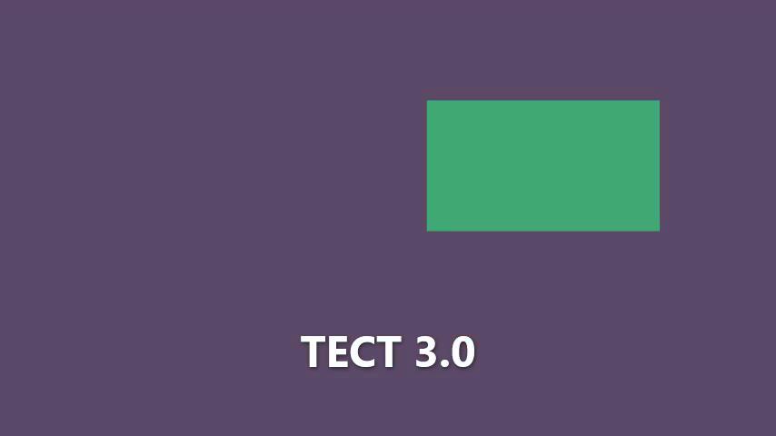

# Tiger Video Edit

Нативный офлайн-редактор музыкальных эдитов на Flutter для Windows 10/11 x64 и Android ARM64. Разрабатываемая версия — **3.0.0**. Сервер, аккаунт и интернет для редактирования и экспорта не нужны. Это локальный кандидат, а не опубликованный production-релиз: точное состояние проверок и внешние ограничения перечислены в [DEVELOPMENT_STATUS.md](DEVELOPMENT_STATUS.md).

## Новое в 3.0

- Главное меню, поиск проектов, локальная музыкальная библиотека и оригинальные синтезированные звуки.
- Независимые массовое применение эффектов и глобальные слои над композицией. Работа по диапазону, сменам медиа и выбранным маркерам; общий выключатель.
- 16 работающих графических примитивов и 29 именованных редактируемых комбинаций Motion/Glitch/Light/Transitions. Это комбинации общего движка, а не 29 отдельных шейдеров.
- Ключевые кадры, 8 кривых, график интерполяции, поиск/избранное/история эффектов; настоящий переход между предыдущим и текущим кадром.
- Дополнительные визуальные и аудиоклипы: перемещение, параметры, обрезка, громкость и Fade In/Out. До 16 одновременно активных клипов каждого вида; звуки можно расставить по маркерам.
- Шесть профилей Auto Edit, шаблоны с безопасным JSON, сохранением/импортом/экспортом/дублированием/переименованием/удалением.
- Экспорт MP4 H.264/AAC, 24/30/60 FPS, 480p/720p/1080p; качество, светлая/тёмная/системная тема, снижение анимаций и сохраняемые ширины панелей.
- Проверка GitHub Releases с кэшем, ручным запуском и проверкой SHA256 загрузки. Установка запускается только отдельной командой пользователя; репозиторий ещё не опубликован.

Jamendo не активирован: условия API требуют отдельного согласования для офлайн-кэширования. Локальная библиотека работает; фиктивного каталога нет. Источники и ограничения: [V3_SERVICES.md](docs/V3_SERVICES.md).

Быстрый старт: «Новый проект» → музыка → медиа → Space/G → эффекты → Ctrl+S → экспорт. Ctrl+A выбирает все изображения; Ctrl+C / Ctrl+V копируют и вставляют эффекты. На сенсорном экране групповое выделение начинается долгим нажатием. «Шаблоны» позволяет выбрать основу до добавления материалов.

Проверенный нативный кадр Windows: 

## Установка и выпуск

Windows: запустите установщик `TigerVideoEdit-3.0.0-Windows-x64-Setup.exe` из `dist` после завершения локальной сборки. Установленное приложение автоматически во время разработки не заменяется.

Android: `TigerVideoEdit-3.0.0-Android-arm64-TEST-debug.apk` — **тестовый debug APK**, не финальная production-подпись. Не устанавливайте его поверх другой подписи без резервной копии: Android может потребовать совпадающий ключ. Реальное устройство пока не проверено.

GitHub Releases ещё не опубликованы; целевой адрес после подтверждения владельца — [Flory211/tiger-video-edit/releases](https://github.com/Flory211/tiger-video-edit/releases). CI и правила выпуска: [CI_RELEASE.md](docs/CI_RELEASE.md), проверка перед публикацией: [PUBLICATION_REVIEW.md](docs/PUBLICATION_REVIEW.md).

## Сохранённые возможности 2.0

Эффекты/пресеты, локальный анализ ритма и автосборка, титры, видеофрагменты и GIF. Подробное руководство: [docs/V2_GUIDE_RU.md](docs/V2_GUIDE_RU.md).

## Работа в приложении

1. Меню ⋮ → «Новый проект». Кнопка с аудиофайлом над таймлайном импортирует MP3/WAV/FLAC/OGG.
2. «Добавить медиа» — JPG/JPEG/PNG/WEBP, GIF и видео MP4/MOV/MKV/WEBM/M4V. Меняйте порядок ручкой справа от строки.
3. Выберите начало и конец музыки в свойствах. Нажмите Play или Space. Отсчёт заканчивается до воспроизведения.
4. Нажимайте G во время музыки. На телефоне используйте большую кнопку «Маркер G».
5. Клик по флажку выбирает маркер; перетаскивание меняет время. В свойствах можно ввести позицию в миллисекундах, удалить маркер. Двойной клик или долгое касание шкалы добавляет маркер вручную. Ползунок справа масштабирует шкалу до 200×.
6. Клик по шкале перематывает. При воспроизведении кадры циклически сменяются по маркерам. Выбор картинки в библиотеке открывает её для настройки; Play и перемотка возвращают просмотр результата.
7. В свойствах изображения: вписать/заполнить, масштаб и смещение. Изображение можно двигать прямо в просмотре.
8. Ctrl+Z / Ctrl+Y — Undo/Redo; Delete удаляет выбранный маркер. Горячие клавиши не действуют внутри текстового поля.
9. Сохранение — значок дискеты или Ctrl+S. В меню доступны открытие, последние проекты, «Сохранить как», переименование и восстановление путей.
10. «Экспорт» создаёт MP4 с H.264/AAC с выбранными FPS/разрешением. Windows предлагает имя/папку, Android — системный диалог сохранения. При недоступном кодеке показывается ошибка.

Настройки: клавиша маркера (буква/цифра), обратный отсчёт, интервал автосохранения 10–600 секунд. Пропорции экспорта выбираются над просмотром.

## Проекты и восстановление

Старые проекты .leos можно открыть. При ручном сохранении создаётся .tve, исходный .leos сохраняется. Старая медиабиблиотека Windows продолжает использоваться, если она уже существует. Идентификатор Android-пакета сохранён для установки обновления поверх предыдущей версии.

Формат `.tve` — JSON версии 3; старые версии 1/2 и `.leos` читаются без изменения исходника при открытии. Исходное аудиовремя хранится в целых микросекундах. Схема 3 сохраняет слои, стеки эффектов, ключевые кадры, дополнительные клипы и настройки экспорта. Медиа не встраиваются в JSON. При импорте приложение копирует медиа в постоянную локальную библиотеку; большие исходники занимают дополнительное место на диске.

Рядом с проектом находятся `.bak` (предыдущая исправная копия) и `.autosave` (автокопия). При открытии основной версии приложение предлагает более новую автокопию. Первое автосохранение создаёт также основной файл, доступный через последние проекты. Можно открыть `.bak` или `.autosave` вручную. Перед закрытием используйте ручное сохранение: принудительное завершение процесса не гарантирует запись последнего изменения.

Относительные пути в переносимых проектах разрешаются относительно JSON. Для отсутствующих или повреждённых исходников используйте «Восстановить пути». На Android проекты сохраняются в локальной библиотеке приложения и доступны из списка последних; удаление приложения может удалить эту библиотеку.

Маркеры на границах отрывка не создают дополнительного переключения. Совпадающие времена объединяются при построении видео. Несколько переключений внутри одного кадра разрешаются последним изображением этого кадра. Маркер начинает действовать на первом кадре **не раньше** его времени. Длительность видео округляется вверх до целого кадра, максимум на 33,34 мс. Хранение микросекунд не гарантирует физическую точность нажатия или аудиовывода.

## Собственные демонстрационные материалы

`demo/Pulse.tve`, три оригинальные PNG и синтезированный `pulse.wav`. Откройте проект через меню. `node tools/generate-demo.cjs` воспроизводит все исходники без внешних материалов. `flutter test tools/render_demo_test.dart` создаёт и проверяет `demo/Pulse.mp4`.

## Сборка

Проверенная базовая версия: Flutter 3.47.8, Dart 3.13.7. Все версии Dart-пакетов зафиксированы в pubspec.lock.

Windows: Visual Studio 2022 с Desktop development with C++, CMake и Windows SDK 10.0.26100. Flutter SDK в `.tools/flutter` либо используйте свой SDK.

```powershell
.\.tools\flutter\bin\flutter.bat pub get
.\tools\bootstrap-windows.ps1
.\.tools\flutter\bin\flutter.bat test
.\.tools\flutter\bin\flutter.bat analyze
.\tools\build-windows.ps1
```

Bootstrap скачивает закреплённый libmpv и проверяет SHA-256; для распаковки нужен 7-Zip или WinRAR. Для упаковки требуется Inno Setup 7.1.1 в `.tools/inno/ISCC.exe`. FFmpeg/ffprobe и сопровождающие DLL берутся из `C:\ffmpeg-master-latest-win64-gpl-shared\bin`; иной путь передайте через `-FfmpegBin`. Скрипт включает библиотеки Visual C++ рядом с EXE. Установленному приложению Flutter SDK не нужен.

Android: минимум API 24 (Android 7.0), ARM64. Для сборки: JDK 21, SDK platform/build-tools 36, NDK 28.2.13676358 и CMake 3.22.1. Flutter/Gradle могут скачать недостающие компоненты при первой сборке.

```powershell
$env:JAVA_HOME='C:\Java_21'
$env:ANDROID_HOME='C:\LeosFastVideoEditor\.tools\android-sdk'
.\.tools\flutter\bin\flutter.bat build apk --debug --target-platform android-arm64
```

Команда создаёт явно тестовый debug APK. Production-сборка `--release` требует настроенных ключа и паролей из окружения; без них выпуск блокируется. Не храните ключи в репозитории. См. [CI_RELEASE.md](docs/CI_RELEASE.md). Установка и экспорт требуют отдельной проверки на реальном Android ARM64.

Нативный Windows-тест отделён от производственных зависимостей: папка `native_test` содержит стандартный Flutter-хост, использующий код основного приложения через path dependency. Это обходит проблему регистратора тестового Android-плагина Flutter 3.47.8.

```powershell
Set-Location native_test
..\.tools\flutter\bin\flutter.bat pub get
..\.tools\flutter\bin\flutter.bat test integration_test\native_smoke_test.dart -d windows --dart-define=LEOS_ROOT=C:/LeosFastVideoEditor
```

## Проверенность и лицензии

Фактические результаты сборок, проверки платформ и оставшиеся ограничения — `DEVELOPMENT_STATUS.md`. Наличие исходников или APK само по себе не означает проверку на устройстве.

Имеющийся файл `LICENSE` (GPLv3) сохранён из версии 2.0. Новая лицензия автоматически не выбиралась; перед первой публикацией нужно подтверждение владельца. Версии и условия нативных библиотек описаны в [THIRD_PARTY.md](docs/THIRD_PARTY.md). Перед распространением бинарников требуется проверить полные соответствующие исходники точных нативных сборок. Публичная публикация не выполнялась.


