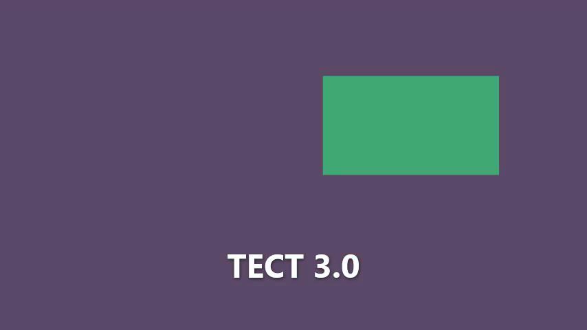

# Native Windows v3 export verification — 2026-10-31

The real Windows integration test passed:

```powershell
Set-Location C:\LeosFastVideoEditor\native_test
..\.tools\flutter\bin\flutter.bat test integration_test/v3_export_test.dart -d windows --no-pub
```

The command used the existing Flutter SDK/C++ cache with authorized sandbox escalation. The first native compilation took 37.3 seconds; the final rerun after logging cleanup took 24.0 seconds, followed by a passing test in approximately 4 seconds. Both runs produced the same measured frame/audio results below. Focused `flutter analyze --no-pub native_test/integration_test/v3_export_test.dart` also reported no issues. The test imports the production model, compositor, storage, audio mixer and VideoExporter directly. A MaterialApp initializes real native system fonts; it does not import application bootstrap or access installed application data.

The synthetic project selects source 1.0–2.5 seconds, uses 24 fps/480p, two original solid images, a marker at 1.5 seconds, local crossfade, a held global flash, a partial green overlay, Cyrillic caption `ТЕСТ 3.0`, and an original procedurally generated Pop with group volume and fades. Music is the repository's original `demo/pulse.wav`. All working media and MP4 output live in a newly created, prefix-checked temporary directory removed after the test.

## Actual results

| Check | Observed result |
|---|---|
| ffprobe codecs | H.264 video + AAC audio |
| Resolution / frame rate / frames | 854×480 / 24 fps / 36 frames |
| Output duration | 1.5 seconds, checked within 0.08 s |
| Frame 18 preview vs decoded H.264 | RGB mean absolute error 1.38425953 / 255; threshold <6 |
| Held global flash | Background pixel `[89,72,104]`; red/blue each >12 above no-flash render |
| Partial overlay | Center pixel `[64,169,115]`; green >red/blue by >25 |
| Native caption | 2,388 bright glyph pixels, bounding-box coverage 0.36965944 |
| Decoded AAC RMS | 0.02891501 |
| SFX difference from volume-adjusted music | RMS 0.07313697 within Pop interval |
| Difference after SFX ends | RMS 0.00022828; required <0.006 |
| Actual export cancellation | Existing MP4 preserved byte for byte; no `.previous` replacement |
| Legacy v1 project | Opened with defaults; original bytes unchanged |

The preview reference independently schedules the selected frame and calls the same production `paintFrame` with previous image, overlay and global layers. The compared frame lies midway through the crossfade and inside the overlay/caption interval. Caption shape assertions reject rectangular Ahem blocks; visual inspection of the decoded PNG confirmed readable Cyrillic text and the expected overlay.



[Canvas reference PNG](V3_NATIVE_PREVIEW.png) is retained alongside the decoded frame. These PNGs are synthetic test evidence suitable for review. The exported temporary MP4 is intentionally deleted after verification.

This proves the exercised Windows native export path. It does not establish Android-device behavior, GitHub-runner execution, production signing or every effect/resolution/frame-rate combination. Production code was not modified during this check.
